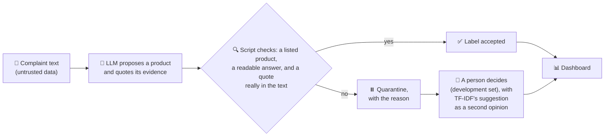

# voc-demo

**Can an AI label customer complaints well enough to trust, and show its evidence for every label?**

This repo tests that on real complaints sent to the US Consumer Financial Protection Bureau (CFPB) in July 2026. An LLM labels each complaint by product and quotes the sentence that supports the label. A script checks the answer and the quote. Anything that fails is held back and never counted as correct. A simple TF-IDF (term frequency, inverse document frequency) model is the bar the LLM must beat.

🌐 **Live public copy:** https://voc-demo-20261030.azurewebsites.net (figures and labels, no complaint text)
📒 **Every step, decision and AI mistake:** [BUILD_LOG.md](BUILD_LOG.md)

## 🎯 In one minute

- **📊 The result.** The claim was fixed before the first run: the LLM, with its quote check, beats TF-IDF at the same coverage. On a sealed test set of 1,909 complaints, scored once, it did: **80.3% against 77.9%**, +2.4 points, with a 95% interval of +0.5 to +4.1. It cost **$0.2373 per 1,000 complaints**. The command and the full figures are under "The result".
- **🖥️ The analyst's tool.** A dashboard with four tabs: the overview, browsing by product, the review queue where a person decides each quarantined complaint of the development set, and the method. On the analyst's own machine, the quoted sentence is highlighted in the complaint's text.
- **🛡️ Safety.** No label is trusted without a quote that a script found in the text. Failures are held back and never counted as correct: on the development set a person decides each one (9 complaints), and on the test set they count as wrong (45 of 1,909). Spend has a hard cap.
- **🔧 How it was built.** From the first commit on 27 October 2026 at 23:53 to 31 October: 54 merged pull requests (`gh pr list --state merged`, 31 October) and 1,294 tests (`pytest --collect-only` on commit `b23a7b5`).

## 🔀 How one complaint is labelled



On the sealed test set, no person reviews: a quarantined complaint counts as wrong.

## ✔️ Who checks what

The AI proposes. Scripts, a baseline, a reviewer and the owner check, each at its own step.

```mermaid
flowchart TB
    subgraph L["Each label"]
        L1["🤖 The AI proposes<br/>a label and a quote"] --> L2["🔍 A script checks the quote<br/>is really in the text"]
        L2 -- fails --> L3["👤 A person decides<br/>(development set)"]
    end
    subgraph M["The method"]
        M1["📏 TF-IDF is the bar to beat,<br/>on the same complaints"] --> M2["🔒 A sealed test set,<br/>scored once"]
    end
    subgraph C["Each pull request, under the rules in CLAUDE.md"]
        C1["🧪 Failing tests first"] --> C2["🧐 A fresh reviewer agent<br/>reads the change"]
        C2 --> C3["⚙️ Continuous integration (CI)<br/>runs the tests with no network"]
        C3 --> C4["☑️ The merge check"] --> C5["🙋 The owner decides<br/>and merges"]
    end
```



## 📊 The result

| Test set, 1,909 complaints | LLM (claude-haiku-5-5, prompt v1) | TF-IDF at the same coverage |
|---|---|---|
| Re-weighted strict accuracy | **80.3%** | 77.9% |
| Coverage | 97.6% | 97.6% |
| Cost per 1,000 complaints | $0.2373 | $0 |
| Time per 1,000 complaints | 2,015.2 seconds | 0.707 seconds |

Source: `uv run --native-tls voc final --prompt v1`, run once by the owner on 29 October 2026, written to [results/eval/v1_test.json](results/eval/v1_test.json).

**Verdict: the LLM beats TF-IDF**, by +2.4 points (95% interval +0.5 to +4.1, paired bootstrap). The LLM's clear weak spot is credit reporting, where TF-IDF does better. The per-product table, the development figures and what each term means are in [docs/RESULTS.md](docs/RESULTS.md). [How we measure](docs/HOW_WE_MEASURE.md) explains the method in plain words.

## 🖥️ The analyst's dashboard

Four tabs: **Overview** (the verdict, a bar per product, and where the data comes from), **Browse** (complaints by product), **Review** (the quarantined complaints a person decides), and **How we measured**.

The live public copy shows the figures and labels, not the complaint text, for three reasons:
- It is built only from this repo, and by rule the repo holds no raw data.
- It is open to anyone, with no sign-in. The CFPB publishes these narratives for anyone to use, so this is not a privacy problem for this data. But for customer data such as sales calls, text must never sit on an open page.
- With no sign-in, anyone could write a review, so it stores none.

The next step for analysts, not built: a signed-in analyst copy, with App Service's built-in sign-in (Microsoft: "Azure App Service provides built-in authentication (signing in users)", [Authentication and authorization in Azure App Service](https://learn.microsoft.com/en-us/azure/app-service/overview-authentication-authorization), dated 28 March 2025), the data in a private store, and each decision saved with the reviewer's name.

## ⚡ Speed · 🛡️ Safety · 📈 Scale

**⚡ Speed**
- $0.2373 per 1,000 complaints. Labelling all 10,002 July complaints with a narrative would cost about $2.37 at that rate ($0.4530015 / 1,909 x 10,002, from the test run. A projection, not a run.)
- Every model answer is recorded, so a re-run of the same prompt replays it at no cost.
- Several pieces of work ran at once, each in its own git worktree, and the build log records them.

**🛡️ Safety**
- Every accepted label has a quote that a script found in the text. That shows the quote is in the text, not that it supports the label. No human has checked that yet.
- 10 made-up complaints try to hijack the model. In one live run, none was obeyed: 9 reached the model, and 1 was caught by the script before any call (`uv run --native-tls voc label injection --prompt v1`, then `voc evaluate injection`).
- Complaint text goes to the model as data, in a call with no tools. Every live call goes through a hard token cap and one shared ledger.

**📈 Scale**
- The July 2026 export holds 672,036 complaints. 10,002 have a narrative (`uv run --native-tls voc profile --write results/profile_july_2026.json`), and 9,303 remain after `voc sample` removed copies ([docs/DATA.md](docs/DATA.md)).
- Loading is incremental, keyed on the complaint identifier (ID). dbt (data build tool) builds the models and runs the data tests, and the same models ran on Databricks with synthetic data.
- A scheduled run does load, dbt build, label and evaluate every day, on synthetic data. The public copy on Azure has a health route and a request log.

**When to switch to bigger tools:** when the data no longer fits on one machine, when many people write at once, or when many pipelines depend on each other. The reasons: [docs/STACK.md](docs/STACK.md).

The details and the commands behind each figure: [docs/RESULTS.md](docs/RESULTS.md).

## 🧭 Decisions the owner made

Claude proposed, the owner decided. Each line is in [BUILD_LOG.md](BUILD_LOG.md) on its day.

- **28 October, overruled: the headline measure.** Claude recommended the quote-only view alone as the headline, with the two methods' agreement as a side report. The owner pushed back: the point is how the two methods work together for better precision, not choosing one.
- **28 October, overruled: the sample sizes.** The owner asked whether Claude was really confident in its sample size rule. It was not: the rule ignored that the decision compares two methods on the same complaints. The owner then chose a simpler method: Cochran's formula for the sizes and a paired bootstrap for the verdict, both explained in plain words in [docs/HOW_WE_MEASURE.md](docs/HOW_WE_MEASURE.md).
- **28 October: the labels.** All 11 CFPB products as they are, with no merging. The two small products are kept, and their limits are written down.
- **29 October: scope.** The human spot check of whether quotes support their labels was cut, and listed as a pending improvement. Databricks was kept.
- **29 October: the spend cap.** When the cap refused the scored run, it was raised to 40,000,000 tokens. Changing the prompt's output limit after tuning, or relaxing the cap check, was turned down.
- **30 October: the analyst screens use the development set.** The test set stays sealed. Claude added a safeguard to this: complaint text appears only when the owner starts the app with `--with-text`.
- **30 October: deploy to Azure the same day,** not on Saturday.
- **30 October, overruled: the title.** Claude proposed plain words in place of "LLM" and "TF-IDF". The owner kept the technical terms, with an explanation beside each, because a technical reader looks for them.
- **30 October: readability.** On the dashboard, every abbreviation except AI, LLM and API is spelled out. Normal text is no smaller than the old verdict line (pull request #54).
- **31 October: the public copy stays without complaint text.** A signed-in analyst copy is named as the next step instead.

## ⚠️ Limits, in short

- The product label was chosen by the consumer, so some measured "errors" are label noise.
- The CFPB says its database "is not a statistical sample of consumers' experiences in the marketplace". The results describe this data only.
- One month, one model, one prompt version and one test run. The improvement loop is ready (`/eval` adds a row to [EVAL_VERSIONS.md](EVAL_VERSIONS.md)) but was not run beyond prompt v1.
- The model's training data ends in June 2026, and the complaints were received in July 2026, so they cannot be in its training data.

All limits, the known gaps in the guards, and notes on the data: [docs/LIMITS.md](docs/LIMITS.md).

## ▶️ Run it yourself

No data, key or account is needed for the tests, the dbt build on synthetic data and the dashboard:

```
uv sync
uv run pytest
uv run python scripts/dbt_fixture_build.py tests/fixtures/dbt/complaints.csv <empty work folder>
uv run voc serve
```

Then open http://127.0.0.1:8000. Labelling real complaints, and loading a new month: [docs/PIPELINE.md](docs/PIPELINE.md).

## 📚 Read more

| Page | What it holds |
|---|---|
| [docs/RESULTS.md](docs/RESULTS.md) | The full results, per product, and Speed, Safety and Scale in detail |
| [docs/HOW_WE_MEASURE.md](docs/HOW_WE_MEASURE.md) | The method, in plain words |
| [docs/PIPELINE.md](docs/PIPELINE.md) | How the pipeline works, Databricks, loading a new month |
| [docs/STACK.md](docs/STACK.md) | Why this stack, and when to switch |
| [docs/DATA.md](docs/DATA.md) | What the data holds |
| [docs/LIMITS.md](docs/LIMITS.md) | Limits, known gaps in the guards, the data source |
| [docs/DEPLOY.md](docs/DEPLOY.md) | The Azure public copy |
| [specs/](specs/) | Every rule. Every test is named after its rule |
| [CLAUDE.md](CLAUDE.md) | How the AI and the owner work in this repo |
| [BUILD_LOG.md](BUILD_LOG.md) | What happened, when, and every AI mistake |
