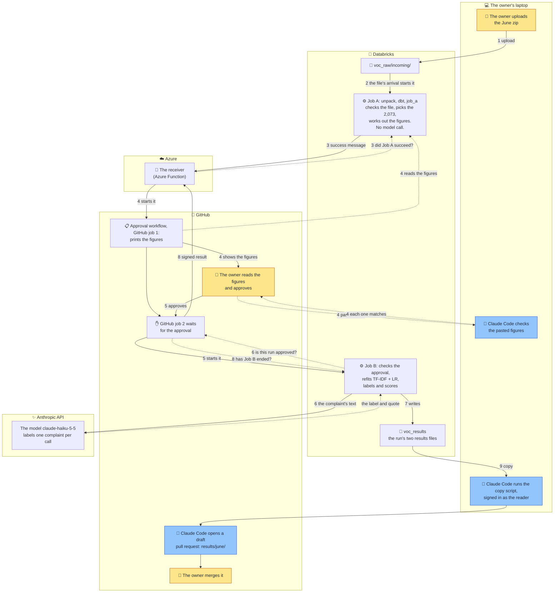

# How the June cloud run passed data

This page shows how the June test passed data between four places: Databricks, Azure, GitHub and the Anthropic API. The test ran once, on 14 November 2026, and labelled 2,073 complaints. Between the upload and the copy of the results, the only laptop step was Claude Code's check of the printed figures. Its figures are in [the validation review](VALIDATION.md#june-the-untouched-test-of-the-mix). The rules behind each step are in [spec 004](../specs/004-june-test-and-baselines/spec.md), J8 to J16.

Two different AIs are called Claude here. **Claude Code** is the AI coding agent that built this repo. It is built and guarded never to read complaint text. **The model claude-haiku-5-5** is the AI that labels the complaints, through the Anthropic API. Anthropic's **Claude Console** is the website where the API key and its spend limit are set.

## In one minute

- **During the run, the complaint text stays in Databricks.** It leaves only to the Anthropic API, one complaint per call, in calls with no tools. Before the run, the owner uploaded the files by hand from the laptop. After it, the owner kept a backup of the data files and of the recordings in a folder on the laptop. The recordings hold each sampled complaint's full text (J15).
- **Azure only passes messages on.** A small receiver hears that a Databricks job finished and starts the next step. It sees run IDs, statuses and counts, never complaint text.
- **GitHub holds the approval.** No paid step starts until the owner has read the planned figures and clicked approve.
- **The results reach this repo as two files** of IDs, labels, quote positions, reasons and counts, with no complaint text. They are copied from the run's own folder, in a store that holds only results.

## Words used here

- **Databricks**: a cloud platform for data and jobs. **Azure**: Microsoft's cloud.
- **Volume**: a folder of files in Databricks. **Schema**: a named group of tables. **Secret scope**: Databricks' locked store for keys.
- **Robot account**: a sign-in for a program, not a person. Here a Databricks service principal.
- **Used markers**: small files Job B writes so the same approval or Job A run can never start a second scoring.
- **Databricks job**: a set of steps Databricks runs, each step a **task**. Here Job A and Job B. A **trigger** starts a job, here when a file arrives. Each run gets a number, its **run ID**.
- **dbt**: a tool that turns raw rows into clean tables and tests them. It runs on Databricks' **SQL warehouse**, the part that runs queries.
- **Pin**: a file's fingerprint (its SHA-256), saved in the repo, so a changed file is refused.
- **The frozen sample**: the 2,073 complaint IDs chosen on 5 November and saved in `splits/june/`, before anything was scored.
- **TF-IDF + LR**: the simple word-based model that is the bar to beat ([How we measure](HOW_WE_MEASURE.md#what-we-compare)).
- **Tokens**: the pieces of text the API counts and charges for. The **ledger** adds them up and stops the run at a cap. The **recordings** keep each prompt, with the complaint's full text, and the model's answer, so a re-run replays it for free.
- **Azure Function**: a small program that runs only when called. Its **queue** holds messages waiting for work, and the **failure queue** holds those that failed 5 times.
- **Key Vault**: Azure's locked store for passwords and keys. **App Service**: Azure's web hosting.
- **Workflow**: a script GitHub runs on its own computers, a feature called **GitHub Actions**. Each workflow has one or more **GitHub jobs**, here GitHub job 1 and GitHub job 2.
- **GitHub environment**: a named set of secrets that only some workflow jobs may use. Here each is limited to `main`, and only `june-run` also waits for the owner's approval.

## The pieces, by place

| Place | Piece | What it does |
|---|---|---|
| Databricks (Free Edition) | volume `voc_raw` | the raw files: the July and August exports, the June zip, and the June run's recordings, ledger and used markers |
| | volume `voc_results` | the real run's two results files, and the dry runs' notes, which hold counts only |
| | Job A, `voc-june-job-a` | checks the June file, builds it with dbt, picks the sample, works out the figures |
| | Job B, `voc-june-job-b` | labels and scores the sample |
| | secret scope `voc-june` | the Anthropic API key and its workspace's ID |
| | `voc-june-runner`, the robot account | may look at both jobs' runs, and start or cancel Job B. It runs no job: both jobs run as the owner |
| | `voc-results-reader`, the reader account | may read `voc_results` and nothing else |
| Azure | the receiver, an Azure Function | takes Databricks' message, checks it, and starts GitHub's approval workflow |
| | its storage | a queue, a failure queue `june-events-poison` and a table of the messages it has seen |
| | Key Vault `voc-june-kv` | the receiver's secrets |
| | App Service `voc-demo-20261030` | the public dashboard, a separate app |
| GitHub | `june_approval.yml` | the approval workflow, with its environments `june-figures` and `june-run` |
| | `deploy.yml` and `deploy_receiver.yml` | deploy the dashboard and the receiver to Azure |
| Anthropic | Anthropic's Claude Console, workspace `voc-june-cloud` | the API key for the cloud run, with a spend limit of $5 a month |
| The laptop | the raw data folders | the July, August and June files, with complaint text, outside the repo. The June sample was drawn here on 5 November |
| | the backup folder | a copy of the data files and the June recordings, kept in sync by a storage service this page does not name |
| | `scripts/copy_june_results.py` | copies the two results files into `results/june/` |

## The June run, step by step

How to read it:
- **Yellow boxes with 👤** are the owner's steps by hand. There are three boxes: the upload, reading the figures and approving, and the merge. The owner also switched Job A's trigger on before the upload and off after the run, which is not drawn.
- **Blue boxes with 🤖** are Claude Code's steps: checking the figures, the copy and the draft pull request.
- **Every other box** runs on its own.
- **Solid arrows** are the main path. **Dotted arrows** are the checks, reads and replies along the way, and the owner's paste of the figures into the chat.

Each step starts with who does it. Times are the owner's local time (UTC+11), from [BUILD_LOG.md](../BUILD_LOG.md), "The June run".

1. **By hand: upload.** The owner drops the June zip into the Databricks volume folder `voc_raw/incoming/`. The owner also switched Job A's trigger on just before, and off again after the run.
2. **Automatic: Job A.** The file's arrival starts it. It has three tasks, run in order:
   - `unpack` unzips the file into `voc_raw/june/` and checks it against its pin in `config/data_files.toml`.
   - `dbt` builds the same dbt models as July, on Databricks' SQL warehouse, in the schema `voc_june`, with the data tests.
   - `job_a` picks the 2,073 complaints of the frozen sample, checks them against `splits/june/`, and works out the figures for the approval. It makes no model call.

   Run `195625699108193`, 12:12 to 12:15.
3. **Automatic: the success message.** Databricks tells the receiver that Job A succeeded, signed in with a user name and password (HTTP Basic). Databricks' message carries no signature, so the receiver does not take it on trust. It answers at once and puts the message on its queue. Then it asks Databricks itself whether that run really succeeded, as the robot account, and checks that no approval run for it exists yet.
4. **Automatic, then by hand, then Claude Code: the figures.** The approval workflow `june_approval.yml` starts, run `43539560019`, at 12:16. The receiver starts it with a GitHub token for this repo's Actions only. Its first GitHub job reads Job A's figures from Databricks and prints them: 2,073 complaints, 2,073 calls, a worst case of 37,954,560 tokens and an expected cost of $0.50. The owner pasted them into the chat at 12:19, and Claude Code checked each against Job A's run page and the repo.
5. **By hand: the approval.** The second GitHub job, `run`, waits in the environment `june-run` until the owner clicks approve on GitHub. No model call has been made before this point. The owner approved at about 12:20, after Claude Code's check. From here the GitHub job runs on its own: it started Job B, as the robot account, passing Job A's run ID and its own GitHub run ID.
6. **Automatic: Job B.** One task, `job_b`. Run `1052842636980751`, 12:20 to 13:41. Before its first model call it checks the approval on GitHub's public API, Job A's run, the frozen code's hashes and the sample. It refits TF-IDF + LR on July's training rows, from the July export already in `voc_raw`, and checks that the refit gives July's committed development labels. Then it sends each complaint to the model claude-haiku-5-5 through the Anthropic API, with the key from the secret scope `voc-june`. Each prompt, with the complaint's full text, is recorded with its answer, and each call's tokens go into a ledger with a cap of 40 million, both in `voc_raw`.
7. **Automatic: the results files.** Job B scores the run and writes `v1_june.csv` and `v1_june.json` to its own folder in `voc_results`.
8. **Automatic: the signed result.** The workflow looked at Job B once a minute. When Job B ended, it posted a result message to the receiver, signed with a shared secret (HMAC): the run IDs, how Job B ended and its counts. The GitHub job ended green at 13:42:51. It ends green only when Job B finished and the receiver accepted the message.
9. **Claude Code, then by hand: the copy and the merge.** At 14:09 Claude Code ran `scripts/copy_june_results.py` on the laptop, signed in as the reader account. It checked the columns, the label and reason lists, the IDs against `splits/june/`, the size limit and that neither file holds the CFPB's header row (J11), and wrote them to `results/june/`. Claude Code opened them as a draft pull request, #137, at 18:38, and the owner merged it at 20:10.

## Who does what

| Step | Who | What |
|---|---|---|
| before 1 | the owner, by hand | switches Job A's trigger on, and off again after the run |
| 1 | the owner, by hand | uploads the June zip |
| 2 and 3 | automatic | Job A runs. The receiver checks it and starts the workflow |
| 4 | automatic, then the owner, then Claude Code | the workflow prints the figures. The owner pastes them into the chat, and Claude Code checks each one |
| 5 | the owner, by hand | approves in `june-run`. Job B then starts on its own |
| 6 to 8 | automatic | Job B labels and scores. The workflow sends the signed result |
| 9 | Claude Code, then the owner | Claude Code copies the results and opens a draft pull request. The owner merges it |

## What crosses each line

| From | To | What travels |
|---|---|---|
| the CFPB's website | the laptop | before the run, downloaded by the owner: the June zip from the CFPB's narratives archive, and earlier the July and August exports. These hold complaint text, which the CFPB publishes |
| the laptop | Databricks | before the run, by hand: the June zip, and on 31 October the July and August exports. These hold complaint text |
| Databricks | the Anthropic API | each complaint's text, one per call, with no tools. Back: a label and a quote |
| Databricks | the receiver | Job A's run ID, job ID and event type, which the receiver reads, and the workspace ID and job name, which it does not. Sent with the Basic sign-in |
| the receiver | Databricks | a question: did this run succeed? |
| the receiver | GitHub | a look at the workflow's runs, then the start of the approval workflow, with Job A's run ID |
| GitHub | Databricks | read Job A's figures, start Job B, look at Job B's run. Both Databricks jobs also fetch their code from this repo's `main` |
| GitHub | the chat with Claude Code | the printed figures, pasted by the owner: numbers only |
| Databricks | GitHub | Job B reads the approval, on the public API, with no token |
| GitHub | the receiver | the signed result: run IDs, how Job B ended, counts |
| Databricks | the laptop, then this repo | the two results files: IDs, labels, confidences, quote positions, reasons, counts and hashes, the columns J11 lists |
| the laptop's data folders | the laptop's backup folder | after the run, on 15 November, by hand: the July, August and June data files. These hold complaint text |
| Databricks | the laptop's backup folder | after the run, on 15 November, downloaded by hand: a zip of the 2,073 June recordings (J15). Each holds the prompt, with the complaint's full text, and the model's answer |
| the laptop's backup folder | a storage service | the same files and recordings, kept in sync. They hold complaint text |

The backup is a folder on the owner's laptop, kept in sync by a storage service this page does not name (the owner's decision, 17 November). It is not in this repo.

During the run, no complaint text crosses any other line (J4). The repo is public, so its Actions logs are public. Every Databricks job and workflow is built to print only IDs, labels, reasons, positions, decisions and counts, and a test checks each one on hostile synthetic text (J5).

## The other paths

**The public dashboard.** After CI passes on a push to `main`, `deploy.yml` uploads the committed files to the App Service app. It signs in to Azure with OpenID Connect: GitHub gives the workflow a short-lived token, and Azure trusts it only for this repo's `main`. No password is stored. The dashboard reads only the committed results, so it holds no complaint text. Details: [DEPLOY.md](DEPLOY.md).

**The receiver's deploy.** `deploy_receiver.yml`, started by the owner by hand on `main`, signs in to Azure the same way, in the environment `receiver-deploy`, as its own identity `voc-receiver-deploy`. Its one role is on the receiver's app: it can deploy code there, change the app's settings and restart it (J13). Details: [RECEIVER_STEPS.md](RECEIVER_STEPS.md).

**Before June: July and August on Databricks.** On 31 October the owner uploaded the July and August exports to `voc_raw` by hand, and ran the same dbt models there from the laptop, with the owner's own token. The owner revoked that token, and deleted its copy on the laptop, on 6 November. Job B later read the July export there for its refit. Details: [PIPELINE.md](PIPELINE.md), "The real exports on Databricks".

## Who can do what

| Sign-in | Kept in | Lets its holder | Today |
|---|---|---|---|
| the robot's secret | the Key Vault, and the environments `june-figures` and `june-run` | look at both jobs' runs, and start or cancel Job B | deleted on 15 November |
| the GitHub token `voc-receiver-dispatch` | the Key Vault | start, re-run and cancel this repo's workflows, delete their runs and logs, and turn workflows off (J13) | deleted on 15 November |
| the reader's secret | the owner's `.env` on the laptop | read `voc_results` | deleted on 15 November |
| the Basic sign-in | the Key Vault, and the Databricks setting `voc-receiver` | send the receiver a success message | kept until the receiver goes |
| the HMAC secret | the Key Vault, and the environment `june-run` | send the receiver a signed result | kept until the receiver goes |
| the Console key `voc-june-job-b` | the secret scope `voc-june` | call the model, within the $5 monthly limit | disabled, ends on 10 December |
| OpenID Connect | nothing stored | deploy from `main` only | in use |

The deletions are the owner's report. Claude Code could not check them. Spec 004's Known limits, "The clean-up after the June run", gives the worst case of each sign-in still kept.

## Running it again

Every piece above is still there until the owner takes it down. Three things stop the chain today:
- Job A's trigger is paused, so an upload starts nothing (step 2).
- The robot's secret and the GitHub token are deleted, so the receiver can no longer ask Databricks about a run or start the workflow (steps 3 and 4).
- The Console key is disabled, so Job B could not call the model (step 6).

Before any new cloud work, follow [DATABRICKS_STEPS.md](DATABRICKS_STEPS.md#before-any-new-cloud-work), "Before any new cloud work".

## Read more

- [spec 004](../specs/004-june-test-and-baselines/spec.md): every rule of the run, J1 to J16, and its Known limits
- [JUNE_RUN_STEPS.md](JUNE_RUN_STEPS.md): the owner's steps on the day of the run
- [DATABRICKS_STEPS.md](DATABRICKS_STEPS.md) and [RECEIVER_STEPS.md](RECEIVER_STEPS.md): how each piece was set up
- [VALIDATION.md](VALIDATION.md#june-the-untouched-test-of-the-mix): what the June run found
