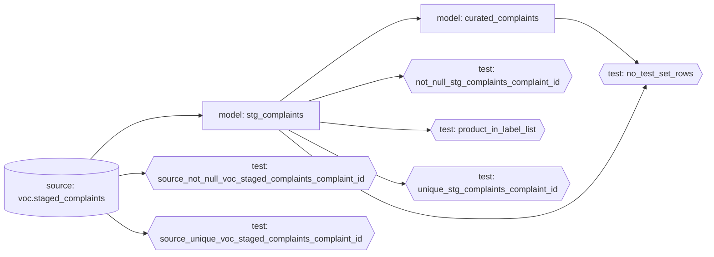

# dbt lineage

Written by `voc dbt lineage` from dbt's `manifest.json` (`dbt parse`). Do not edit it by hand.
It holds node names and edges only: no paths, no SQL and no descriptions.
It shows the local DuckDB target. The two seeds of the Databricks target (T021) are off there,
so they are not drawn.

1 sources, 0 seeds, 2 models, 6 data tests, 9 edges.

